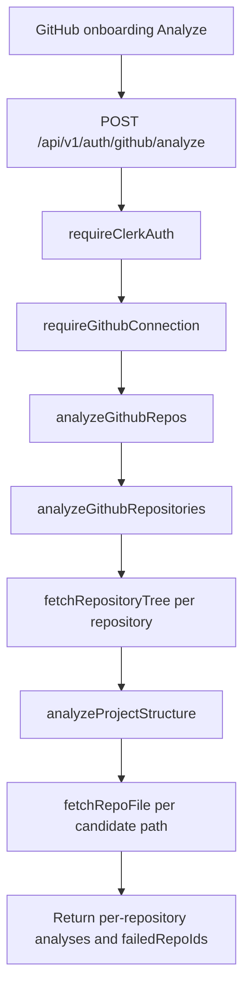

# GitHub Analysis Pipeline Orchestration

> Endpoint, service, GitHub connection, and tree-fetching boundaries for repository analysis.

---

## 1. Core Philosophy

- GitHub API access belongs at the route/service boundary.
- Individual analyzers receive normalized data and do not fetch remote data.
- Client-facing GitHub responses must be mapped through explicit DTO mappers.

---

## 2. Architecture Overview

```text
GitHub repo IDs selected by user
  └─ POST /api/v1/auth/github/analyze
      ├─ require Clerk authentication
      ├─ require saved GitHub connection
      └─ invokes analyzeGithubRepositories and returns per-repository GitHub metadata, summaries, detected areas, maturity signals, architecture signals, candidate file paths and candidate file contents, plus `failedRepoIds` for selected repositories that could not be analyzed

GitHub App installation
  └─ callback verifies user access to installation
      └─ stores installation ID and short-lived installation token
          └─ protected GitHub routes refresh token before use
```

---

## 3. Key Files & Entry Points

| File                                                               | Purpose                                                                                                                                                  | When to Read                                 |
| ------------------------------------------------------------------ | -------------------------------------------------------------------------------------------------------------------------------------------------------- | -------------------------------------------- |
| `apps/backend/src/routes/github.router.ts`                         | Registers GitHub OAuth, repo listing, connection, and temporary analysis routes.                                                                         | GitHub endpoint changes                      |
| `apps/backend/src/schemas/github.schema.ts`                        | Zod request body schema and inferred type for temporary GitHub analysis.                                                                                 | GitHub request validation changes            |
| `apps/backend/src/controllers/github.controller.ts`                | Reads validated selected repo IDs and calls GitHub analysis service.                                                                                     | GitHub request/response changes              |
| `apps/backend/src/mappers/github.mapper.ts`                        | Maps internal GitHub models into client-safe response DTOs with explicit field allowlists, and a repository listing item into the analysis response's `GithubRepositoryMetadata`. | GitHub response DTO changes                  |
| `apps/backend/src/middleware/github-auth.ts`                       | Requires a saved GitHub connection after Clerk auth and attaches it to `res.locals.githubConnection`.                                                    | GitHub-protected route changes               |
| `packages/shared/src/types/github.ts`                              | Defines full backend GitHub connection and client-safe public connection response types.                                                                 | GitHub API contract changes                  |
| `apps/backend/prisma/schema.prisma`                                | Persists the installation ID plus the cached, expiring installation token for each Clerk user.                                                           | GitHub connection persistence changes        |
| `apps/backend/src/services/github.service.ts`                      | Initiates the installation flow, verifies callbacks, manages installation tokens, and fetches repositories, recursive trees (`fetchRepositoryTree`) and file text (`fetchRepoFile`) through the Octokit client. | GitHub connection, token lifecycle or GitHub fetch changes |
| `apps/backend/src/services/github-analysis.service.ts`             | Runs the temporary analyze orchestration: fetches selected repos and trees, normalizes entries, reads candidate files, and returns per-repository analyses plus `failedRepoIds`. It decides which GitHub failures degrade one repository or file and which reject the call. | GitHub analysis orchestration changes        |
| `apps/backend/src/lib/octokit.ts`                                  | Octokit client factory: pinned REST API version, pagination, retry and fail-fast throttling plugins.                                                     | GitHub client behavior changes               |
| `apps/backend/src/lib/octokit-error.ts`                            | Translates an Octokit `RequestError` into an `AppError` by what the failure means.                                                                      | GitHub error mapping changes                 |
| `apps/backend/src/middleware/error.ts`                             | Global error handler; applies the Octokit error mapping to every `RequestError`.                                                                         | GitHub error response changes                |
| `packages/shared/src/types/github-analysis.ts`                     | Analyze response contract (`AnalyzeGithubReposResponse`, `AnalyzedGithubRepository`, `CandidateFileContent`) and the analyzer's public result types.     | Analyze response changes                     |
| `apps/backend/src/utils/github-utils.ts`                           | Shared pure GitHub helpers: raw tree types, full-name parsing, and tree entry normalization.                                                             | Tree normalization or repo parsing changes   |

---

## 4. Data Flow

### 4.1 Temporary Analyze Endpoint Flow



`fetchRepositoryTree` failures with 404, 409 or 422 put the repository in `failedRepoIds`. `fetchRepoFile` returns `null` for a 404, so that candidate file gets `content: null`. Every other GitHub failure rejects the whole call; see 6.3.

---

## 5. Component / Module Structure

```text
apps/backend/src/
├── routes/
│   └── github.router.ts
├── controllers/
│   └── github.controller.ts
├── lib/
│   ├── octokit.ts
│   └── octokit-error.ts
├── middleware/
│   ├── error.ts
│   └── github-auth.ts
├── mappers/
│   └── github.mapper.ts
├── utils/
│   └── github-utils.ts
└── services/
    ├── github-analysis.service.ts
    └── github-analysis/
        ├── project-structure/            # implemented
        ├── dependency-config-analyzer.ts # future
        ├── source-code-analyzer.ts       # future
        ├── test-quality-analyzer.ts      # future
        ├── readme-docs-analyzer.ts       # future
        ├── ci-cd-analyzer.ts             # future
        ├── commit-analyzer.ts            # future
        └── pull-request-analyzer.ts      # future
```

---

## 6. Patterns & Conventions

### 6.1 Analyzer Boundary

- **Rule**: Analyzers receive normalized data and return structured results.
- **Rule**: GitHub API calls belong in orchestration/service code, not inside individual analyzers.
- **Rule**: Use one object parameter for exported functions.
- **Anti-pattern**: Do not pass repo IDs into analyzers and let each analyzer refetch the same GitHub data.

### 6.2 GitHub Connection Boundary

- **Rule**: GitHub-token routes must run `requireClerkAuth` before `requireGithubConnection`.
- **Rule**: `requireGithubConnection` refreshes an installation token that is within five minutes of expiration before attaching `res.locals.githubConnection`.
- **Rule**: `/connection` remains Clerk-only because it is the status endpoint used to detect whether the user is connected.
- **Rule**: `/connection` must return `GitHubConnectionResponse | null` and must never expose the installation ID or stored installation token to the browser.
- **Rule**: Any client response derived from a token-bearing/internal GitHub object must use a response DTO mapper with an explicit field allowlist.

### 6.3 GitHub Client and Failure Handling

- **Rule**: Calls made through `createOctokit` throw Octokit's `RequestError` for every non-2xx response (404 included); a network failure also arrives as a `RequestError` with status 500. The client does not retry 400, 401, 403, 404, 409, 410, 422, 429 or 451, does not wait out a rate limit, and pins `x-github-api-version`.
- **Rule**: The global error handler converts every `RequestError` with `mapOctokitErrorToAppError`:

| GitHub response                                                                                    | `ErrorCode`                                    | HTTP status |
| -------------------------------------------------------------------------------------------------- | ---------------------------------------------- | ----------- |
| 429, or 403 with `retry-after`, `x-ratelimit-remaining: 0` or a "rate limit" message               | `RATE_LIMIT_EXCEEDED` (message carries a wait) | 429         |
| 401, or any other 403                                                                              | `GITHUB_CONNECTION_REQUIRED`                   | 401 / 403   |
| 404 on `/app/installations/{id}` or its `/access_tokens` (app uninstalled)                         | `GITHUB_CONNECTION_REQUIRED`                   | 403         |
| 5xx, including network failures                                                                    | `GITHUB_API_ERROR`                             | 502         |
| Any other 4xx (the request we built was wrong)                                                     | `INTERNAL_ERROR`                               | 500         |

- **Rule**: A suspended installation is detected in `getValidInstallationToken` (only when it refreshes a token) and throws `GITHUB_APP_SUSPENDED` with status 403; it is not produced by the mapper.
- **Rule**: The analysis service decides that a tree failure is local: a tree request answered with 404, 409 or 422 puts that repository in `failedRepoIds`. A missing file is handled inside `fetchRepoFile`, which returns `null` for a 404 (so the candidate file gets `content: null`) and rethrows everything else; the analysis service has no per-file catch. Everything else is rethrown, because it affects every repository (rate limit, rejected token, GitHub outage) or is not understood.
- **Anti-pattern**: Catching all errors around `fetchRepoFile` or `fetchRepositoryTree`. It hides rate limits and the reconnect flow behind empty results.
- **Limit**: `exchangeCodeForToken`, `verifyGithubUserCanAccessInstallation`, `getGitHubUser`, `fetchRepoCommits`, `fetchRepoPullRequests` and `fetchRepoReadme` still use raw `fetch` and raise their own `AppError`s; the mapping above does not apply to them.

---

## 7. Integration Points

| Domain                     | Relationship                                                                   | Key Interface                                 |
| -------------------------- | ------------------------------------------------------------------------------ | --------------------------------------------- |
| Onboarding                 | GitHub repo selection calls the temporary analyze endpoint; `GitHubStep` maps the error codes in 6.3 to error pages or toasts and warns about `failedRepoIds`. | `AnalyzeGithubReposInput`, `AnalyzeGithubReposResponse` |
| Auth                       | GitHub-token routes require Clerk auth and saved GitHub connection middleware. | `requireClerkAuth`, `requireGithubConnection` |
| Project structure analysis | Service normalizes GitHub tree entries before invoking the analyzer.           | `AnalyzeProjectStructureInput`                |

### 7.1 GitHub App Connection & Environment Configuration

The backend connects to GitHub through a repository-scoped GitHub App. The installation is the durable connection boundary; a GitHub user authorization token is used only during the callback to verify that the authenticated user can access the selected installation.

1. **Initiation (`POST /api/v1/auth/github`)**: Generates a cryptographically random 32-byte Base64URL `state`, stores `github_oauth_state:<state> -> clerkUserId` in Redis with a 15-minute TTL, and returns `{ authUrl }` pointing to `https://github.com/apps/<GITHUB_APP_SLUG>/installations/new?state=<state>` for the client to navigate to. The frontend calls this through `initiateGithubAuthAction` rather than a direct browser redirect, so installation-precondition failures surface as a normal action error instead of a raw page.
2. **Callback (`GET /api/v1/auth/github/callback`)**: Atomically consumes the state with Redis `GETDEL`, confirms the matching Clerk user, exchanges the callback code for a user token, and verifies that the user can access the returned installation.
3. **Connection persistence**: The callback signs an app JWT (nine-minute lifetime, issued sixty seconds in the past), obtains a short-lived installation token through Octokit, and upserts `installationId`, `installationAccessToken`, and its expiration. GitHub-protected routes refresh the token with a five-minute buffer before using it; a refresh first reads the installation and throws `GITHUB_APP_SUSPENDED` when it is suspended. The former single retry of a 401 on token creation was removed with the move to Octokit.
4. **Migration boundary**: The migration deletes legacy OAuth connection records because they cannot be converted into GitHub App installations; affected users reconnect through the installation flow.

The backend validates GitHub App configuration through `apps/backend/src/config/env.ts` (`GITHUB_APP_SLUG`, `GITHUB_APP_ID`, `GITHUB_APP_CLIENT_ID`, `GITHUB_APP_CLIENT_SECRET`, `GITHUB_APP_CALLBACK_URL`, and normalized PEM `GITHUB_APP_PRIVATE_KEY`). Temporary legacy aliases stay confined to the configuration boundary while call sites transition.

---

## 8. Implementation Status

- [x] Temporary analyze endpoint accepts selected repository IDs and returns project-structure summaries and detected areas
- [x] Resumed temporary analyze endpoint orchestration and project-structure summaries
- [x] GitHub connection middleware boundary
- [x] GitHub App installation connection and installation-token refresh
- [x] Client-safe GitHub response mapper
- [x] Analyze response carries per-repository GitHub metadata (name, description, URL, topics, fork flag, language) from the repo listing, not the tree
- [x] Recursive GitHub tree fetcher (`fetchRepositoryTree` in `github.service.ts` since 2026-10-23; the separate `github-tree-fetcher.ts` was removed)
- [x] Tree entry normalization
- [x] Octokit client with pagination, retry and fail-fast throttling for installation, repository, tree and file requests
- [x] Octokit failures mapped to `ErrorCode`s in the global error handler
- [x] Repositories that cannot be analyzed reported in `failedRepoIds` while the others still return
- [x] Candidate file contents read per repository and returned as `candidateFileContents` (unverified, see Risks)
- [ ] Multi-analyzer orchestration beyond project structure
- [ ] Evidence aggregator
- [ ] AI resume synthesis integration

---

## 9. Risks & Mitigations

| Risk                                                             | Mitigation                                                                             |
| ---------------------------------------------------------------- | -------------------------------------------------------------------------------------- |
| OAuth token leaks into client response                           | Always map internal GitHub connection models through `github.mapper.ts`.               |
| Legacy OAuth connections are treated as GitHub App installations | Delete incompatible records in the migration and require affected users to reconnect.  |
| An installation token expires during a protected request         | Refresh cached tokens five minutes before expiry in `requireGithubConnection`.         |
| Analyzers refetch the same GitHub data repeatedly                | Keep analyzers pure and pass normalized tree/file data from the service layer.         |
| Temporary endpoint response becomes a final contract too early   | Keep temporary analyze output explicit and document future pipeline stages separately. |
| A per-file or per-repository catch swallows a connection-wide failure | Handle only the statuses listed in 6.3 locally and rethrow everything else. |
| An installation with more than 100 repositories lists only the first 100 | Known limit: `fetchGithubRepos` fetches one page and pagination is deferred. The picker's `total_count` is the number of repositories returned, not the installation's real total. |
| One rate-limited or failing request fails every selected repository | By design: those failures are shared, so the call rejects with `RATE_LIMIT_EXCEEDED` or `GITHUB_API_ERROR`. An analyze call fires one file request per candidate path (a capped list per repository, three repositories at most), all at once. |
| The 2026-10-23 Octokit migration and candidate file reads are unverified | No test or lint was run, so `octokit-error.test.ts` and `error.test.ts` are unchecked, and the backend typecheck was not re-run after the final refactors. One unauthenticated read-only request to the public contents endpoint confirmed that Octokit's `%2F`-encoded nested paths return file text and that a missing file throws 404. |
| `apps/backend/tsconfig.json` moved to `NodeNext` in the same worktree | The reason and runtime effect are not recorded or verified here; see the dependency-management changelog. |
| GitHub routes, including `POST /api/v1/auth/github/analyze`, are not rate limited | Deliberate as of 2026-10-27 (the reason is not recorded). `githubAuthRateLimiter` and `githubApiRateLimiter` exist in `middleware/rateLimiter.ts` but are not applied. Clerk auth still gates every GitHub route, and the Octokit client fails fast with `RATE_LIMIT_EXCEEDED` when GitHub throttles. |

---

## 10. History & Decisions

- **Changelog:** [changelog.md](changelog.md)
- **Architecture decisions:** [adr/](adr/)
- Historical domain-level entries may also live in the parent changelog.
